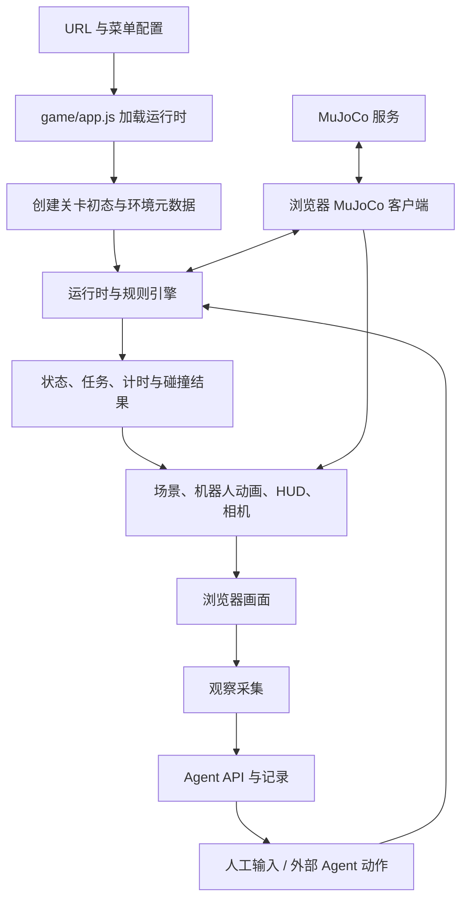

# ARC 项目全景说明

> 初次整理：2026-10-15；文件分类补充：2026-10-16。本文依据权威服务器当前工作区的源码、配置、已有文档和本次检查结果编写，覆盖项目用途、40 个入口、架构、Agent、仿真、资产、运行部署和维护。
>
> 权威工作区：`chenhaoyuan@127.0.0.1:.`。Mac 上的同名目录仅作为控制面。当前工作区包含大量尚未提交的改动，因此本文描述的是工作区快照，不能仅用 Git HEAD 重现。
>
> “源码中已实现”“某个固定版本已发布”“本次已验证”分别说明；本文不代表全部关卡已经通过完整浏览器验收。

## 目录

1. [项目定位与当前规模](#1-项目定位与当前规模)
2. [技术栈与目录结构](#2-技术栈与目录结构)
   - [服务器目录关系](#23-服务器上的三个相关根目录) · [分类速查](#24-项目文件的分类方法) · [关键文件作用](#25-根目录文件分别做什么) · [素材与发布位置](#29-public运行素材发布包和检查页混合存放) · [同名副本与隐藏文件](#212-隐藏目录同名副本和待确认文件)
3. [页面入口、版本与编号](#3-页面入口版本与编号)
4. [完整关卡清单](#4-完整关卡清单)
5. [浏览器架构与状态流](#5-浏览器架构与状态流)
6. [操作、视角与机器人](#6-操作视角与机器人)
7. [碰撞、物理与 MuJoCo](#7-碰撞物理与-mujoco)
8. [Agent 接入与评测](#8-agent-接入与评测)
9. [环境种子与可复现性](#9-环境种子与可复现性)
10. [资产组织与关卡生产](#10-资产组织与关卡生产)
11. [运行、配置与部署](#11-运行配置与部署)
12. [测试与本次验证结果](#12-测试与本次验证结果)
13. [常见问题与排查](#13-常见问题与排查)
14. [开发维护与现存问题](#14-开发维护与现存问题)
15. [文档与代码阅读索引](#15-文档与代码阅读索引)

## 1. 项目定位与当前规模

ARC 当前是一个浏览器端机器人任务环境：玩家或 AI Agent 控制类人机器人，在工业、家庭、图书馆、酒店、诊所、农场等场景中完成移动、取放、归位、设施操作、动态事件处置与协作任务。

项目同时承担几类用途：

- **人工试玩**：通过键盘或屏幕控制台操作机器人，检查玩法、动作、空间布局和视觉效果。
- **Agent 任务执行与评测**：通过 Episode API、截图观察、动作队列和结果记录，运行外部模型或工具型 Agent。
- **机器人控制实验**：包含 G1/R1 展示、G1 速度策略、29DOF 关节目标和 MuJoCo 桥接。
- **写实关卡生产**：把生成资产、扫描场景、GLB 碰撞和交互物整合到统一网页运行器。
- **真实场景重建验证**：使用 Gaussian Splatting 与独立碰撞，检查重建场景中的机器人显示与运动。

当前规模和边界：

| 项目 | 当前情况 |
| --- | --- |
| 主菜单与源码注册 | 40 个 level ID，包括系列变体和测试入口 |
| 用户可见编号 | RF-01 至 RF-13，并包含子关卡；另有无编号实景测试与 TEST 场景 |
| 视角 | 第一、第三、同步双视角；默认第三视角 |
| 机器人 | G1 EDU2 和 R1 EDU；部分关卡限定机器人或控制方式 |
| 主要前端 | 原生 JavaScript ES Modules + Three.js + Vite |
| 后端 | Node HTTP API、SQLite Episode 平台、WebSocket 仿真桥 |
| 仿真 | Python MuJoCo、ONNX 速度策略；部分浏览器 Rapier/网格碰撞 |
| 素材 | GLB、PBR 贴图、MP3、Gaussian 资产、独立碰撞与清单 |
| 测试 | 94 个非隐藏 `tests/*.test.mjs` 文件；另有 5 个 Python 测试文件 |
| 版本关系 | 当前源码、固定试玩发布包、预览/QA 页面同时存在 |

项目名称在不同位置仍有历史差异：README 使用 “Robot Archive / 类人机器人解谜 Demo”，npm 包名为 `relay-facility-3d`，版本为 `2.0.0`。本文统一称为 ARC；包版本不能代表所有关卡资源版本。

## 2. 技术栈与目录结构

### 2.1 主要依赖

以下为 `package.json` 或 requirements 中的声明，不等同于每台机器实际安装版本：

| 技术 | 声明版本 | 用途 |
| --- | --- | --- |
| Node.js | `>=20.19` | Vite、服务端、工具与 Node 测试 |
| Three.js | `0.180.0` | 主场景、机器人、相机、GLB 与空间音效 |
| Vite | `6.0.11` | 开发服务、多入口构建、API 代理 |
| `three-mesh-bvh` | `^0.9.14` | 网格空间查询与碰撞辅助 |
| Rapier | `@dimforge/rapier3d-compat 0.19.3` | 部分浏览器场景碰撞/物理 |
| Spark | `@sparkjsdev/spark ^2.1.0` | Gaussian 场景与相关渲染 |
| PlayCanvas | `^2.21.4` | 部分 GSplat 彩色渲染 |
| `puppeteer-core` | `^25.5.0` | 托管 Chromium、截图与浏览器测试 |
| `ws` | `^8.18.0` | Node WebSocket 网关 |
| MuJoCo | `3.3.7` | G1 物理与控制 |
| NumPy / ONNX Runtime | `2.3.3` / `1.22.1` | 数值计算与策略推理 |
| PyYAML / websockets | `6.0.2` / `15.0.1` | 策略配置与仿真服务 |
| SciPy / OSQP | `1.17.1` / `1.1.3` | RF15 接触/平衡实验的额外依赖 |

**运行完整服务端需要支持 `node:sqlite` 的 Node。** 包文件中的最低版本不足以表达这一要求；本次服务器实际使用 Node `v22.18.0`、npm `10.9.3`。部署时优先使用已验证版本或兼容的较新版本，并实际测试 `node:sqlite` 导入。

### 2.2 目录职责

```text
arc-game/
├── index.html                  统一首页、选关、HUD、操作控制台
├── game/
│   ├── app.js                  路由、运行循环、输入、机器人、Agent 连接
│   ├── levels/<level>/         各关的配置、规则、场景、运行时与系列入口
│   ├── rf01-shared-*.js        RF01 工业园系列共享实现
│   ├── robot.js                机器人配置与动画集成
│   ├── robot-action.js         互动动作状态与展示同步
│   ├── unitree-*.js            G1/R1 模型、关节与显示
│   ├── dexterous-hand.js       灵巧手模型与动作辅助
│   ├── mujoco-client.js        浏览器仿真客户端和位移投影
│   ├── rapier-runtime.js       浏览器 Rapier 封装
│   ├── agent-actions.js        外部 Agent 的标准离散动作
│   ├── environment-seed.js     随机关卡登记与随机流
│   └── episode-environment.js  初态创建、种子元数据和指纹
├── server.mjs                  HTTP 服务、模型代理、录制、WS 入口
├── server/
│   ├── agent-platform.mjs      Episode、SQLite、命令、观察、排行榜
│   ├── model-client.mjs        内置模型代理
│   ├── mujoco-bridge.mjs        WebSocket 上游连接与桥接
│   ├── level-menu.mjs          共享菜单与规范化导航
│   └── level-menu-plugin.mjs   Vite 中的发布页菜单同步
├── simulation/                 Python MuJoCo 服务、环境与实验模块
├── public/
│   ├── agent-kit/             Node/Python 示例与接入提示词
│   ├── local-assets/          服务器本地资产，通常不进 Git
│   ├── office-scan/           扫描办公室素材
│   ├── vendor/                浏览器运行所需第三方资产，例如 Draco
│   └── rf*.../                固定发布包、候选、预览与证据目录
├── integrations/opencode/     OpenCode 配置示例与提示词
├── tools/                     Agent/MCP、资产处理、生产检查、服务文件
├── production/                制作中间文件与项目资料，主要不进 Git
├── tests/                     Node 回归测试
├── docs/                      协议、开发、生产和关卡说明
├── legacy/                    保留的早期 2D 原型
├── data/                      Episode 数据库、轨迹、截图、录制
├── dist/                      构建产物
├── vite.config.js             构建入口、资产复制、固定发布路由
└── .githooks/pre-commit        文件类型、敏感文件和体积检查
```

根目录及 `tools/`、`public/` 中还有独立预览和 QA 文件。判断正式入口应先查看 `game/app.js` 与 `vite.config.js`，不能仅凭文件名。README 中提到的 `native/` Godot 目录在本次服务器工作区未找到。


### 2.3 服务器上的三个相关根目录

2026-10-16 补充核查：当前环境不只依赖 Git 仓库。至少要区分以下三处目录，以及用户级服务配置：

```text
/path/to/arc-workspace/
├── arc-game/                         本项目权威工作区
│   ├── game/、server/、simulation/     游戏、API 与仿真源码
│   ├── tools/、tests/、docs/           制作工具、测试、说明
│   ├── public/local-assets/           运行素材及部分制作/历史素材
│   ├── public/<发布版本>/             实体目录，或指向外部 production 的软链接
│   ├── production/                   仓库内的制作资料，主要按单关组织
│   ├── dist/                         当前构建产物
│   └── data/                         运行时数据
├── production/                       仓库外的系列制作、发布和验收文件
│   └── <系列>/<release 或 build>/     多个线上固定入口实际读取这里
└── arc-mujoco-runtime/                仓库外的 G1 仿真运行环境
    ├── env/                          Python 解释器与依赖
    └── vendor/                       MuJoCo XML、网格、ONNX 策略、配置等

/home/project-user/.config/systemd/user/
├── arc-web-gateway.service            当前用户级网关服务配置
└── arc-mujoco.service                 当前用户级仿真服务配置
```

`arc-game/production/` 与 `./authoring/server-production/` 不是同一个目录。`arc-mujoco-runtime/` 中同时存在 `env/` 与 `venv/`，当前服务使用的是 `env/bin/python`，不能仅凭虚拟环境目录名判断现役版本。`tools/*.service` 是仓库中的服务模板；systemd 实际加载的 unit 路径见上图。修改模板不代表已更新或重启运行中的服务。

本文下面的相对路径，除非特别写出绝对路径，均相对于 `./`。

### 2.4 项目文件的分类方法

先判断文件的**用途、是否被当前入口引用、是否能重新生成**，再判断应否纳入 Git。文件扩展名和所在目录只能提供线索。

| 类别 | 典型路径 | 主要作用 | 与运行/维护的关系 |
| --- | --- | --- | --- |
| 游戏与页面源码 | `index.html`、`game/`、CSS、`agent-guide.*` | 玩家界面、场景、规则、机器人、输入 | 修改功能的主要位置；固定发布包可能运行旧副本 |
| 服务端与仿真源码 | `server.mjs`、`server/`、`simulation/` | API、会话、评分、WebSocket、机器人控制 | 服务进程实际执行；仿真另依赖仓库外环境 |
| 工程配置 | `package.json`、`vite.config.js`、锁文件、Git 配置文件 | 依赖、构建、路由、提交规则 | 决定项目如何启动和产出 |
| 运行素材 | `public/local-assets/`、`public/office-scan/`、`public/vendor/` | 模型、贴图、音效、扫描场景、解码器 | 多数不进 Git，但可能是页面正常运行的必要条件 |
| 固定发布产物 | `public/rf*-r*`、`public/rf*-build*` 及其软链接目标 | 某次已冻结的 HTML、JS、CSS 和依赖 | 部分线上试玩正在使用，不能当普通缓存 |
| 当前构建产物 | `dist/` | `npm run build` 输出 | `server.mjs` 的静态根目录；可重建，但不能随意替换正在使用的版本 |
| 制作过程文件 | 两处 `production/`、资产中的原始模型/requests/candidates 等 | 生成、规范化、减面、返工、制作规划 | 用于重新制作与溯源，不一定由游戏直接加载 |
| QA 与验收证据 | `*qa*`、`*review*`、`*evidence*`、acceptance 文档 | 检查页面、测量脚本、截图、报告 | 脚本可能是源码，截图/录像是证据；二者要分别管理 |
| 运行数据 | `data/agent-platform/`、`data/recordings/` | Episode、命令、记忆、截图、结果 | 不是构建缓存；清空会丢失运行记录 |
| 依赖与工具环境 | `node_modules/`、`.tooling/`、`arc-mujoco-runtime/` | 已安装软件、转换器、解释器与模型策略 | 与源码分开管理；恢复依赖还需版本与配置 |
| 历史、备份和来源待确认文件 | `legacy/`、`.backups/`、根目录重复文件等 | 保留旧实现、快照或迁移残留 | 是否能删除需另做引用和来源核查 |

“源文件”不等于“当前在线入口”，“生成文件”也不等于“随时可删”。例如固定发布 JS 是构建生成的，但当前试玩可能正通过它运行。

### 2.5 根目录文件分别做什么

| 文件或文件组 | 作用 | 使用时要注意 |
| --- | --- | --- |
| `index.html` | 主页面结构、菜单、HUD、操作台和覆盖层 | 源码入口明确加载 `/game/app.js` |
| `styles.css` | 主游戏界面样式 | 影响页面布局与视觉，不定义任务规则 |
| `operator-console.css` | 屏幕操作控制台样式 | 与 `game/operator-controls.js` 配套 |
| `agent-guide.html/.css/.js` | 网页 Agent 接入说明和展示行为 | 属指南页面，不是 Agent 模型执行器 |
| `g1-edu2.html`、`r1-view.html` | G1/R1 模型预览页 | 分别加载 `game/g1-edu2-preview.js`、`game/r1-view.js` |
| `rf12-preview.html`、`rf13-preview.html`、`rf14-preview.html`、`rf15-preview.html` | 对应关卡环境预览 | 各自加载 `game/levels/<id>/preview.js` |
| `rf13-assets.html`、`rf14-assets.html`、`rf15-field-review.html` | 道具或场景检查页 | 检查入口，不额外算正式 gameplay 关卡 |
| `server.mjs` | Node 服务进程入口 | 提供 dist 静态服务、API 和 MuJoCo WS |
| `vite.config.js` | 开发代理、固定发布路由、构建入口、素材复制清单 | 查“页面到底加载哪个版本”优先看这里 |
| `package.json` | npm 脚本、依赖、包信息 | `test` 只匹配 `tests/*.test.mjs` |
| `package-lock.json`、`pnpm-lock.yaml` | npm/pnpm 依赖版本锁定 | 应按团队采用的包管理器维护，不混着更新 |
| `pnpm-workspace.yaml` | pnpm 工作区/构建许可配置 | 当前内容含待明确的 esbuild allowBuilds 配置，不能当完整安装说明 |
| `AGENTS.md` | 本仓库工作区与提交规则 | 不是游戏运行配置 |
| `README.md` | 早期项目说明与快速上手 | 部分信息已过时，需结合本文和源码 |
| `LICENSE` | 源码许可声明 | 不能代替第三方模型、贴图和音频各自的许可 |

根目录另有 `app.js`、`app.route.js`、`level.js`、`preview.js`、`rf15/` 等同名/近似文件，详见 2.12。不要因为它们位于根目录，就默认它们是主版本。

### 2.6 `game/`：浏览器游戏代码如何分组

| 功能组 | 主要文件 | 作用 |
| --- | --- | --- |
| 应用总入口 | `game/app.js` | 选择关卡、加载 runtime、创建渲染器、驱动主循环、接入人工/Agent |
| 通用移动 | `movement.js`、`g1-locomotion.js` | 前后/平移/转向计算及相关运动参数 |
| UI 输入 | `operator-controls.js` | 屏幕按住移动、互动、重置、停止、状态显示 |
| 视角 | `view-mode.js`、`third-person-view-controls.js` | 视角选择、双视口划分、第三视角环绕/缩放 |
| 机器人总装 | `robot.js`、`robot-action.js` | 机器人配置、动画、抓取/放下动作时间与显示状态 |
| 机器人模型 | `unitree-g1-edu2.js`、`unitree-g1-dex1-model.js`、`unitree-r1-edu.js`、`dexterous-hand.js` | 模型、关节、手部、相机挂载和动作辅助 |
| 仿真连接 | `mujoco-client.js` | WS 会话、控制命令、仿真状态、位移投影 |
| 浏览器碰撞/物理 | `rapier-runtime.js`、`g1-articulated-collision.js` | Rapier 初始化、机器人关节碰撞表示 |
| 声音 | `audio.js` | 声音资源映射和播放；部分系列有独立声音模块 |
| Agent 动作 | `agent-actions.js` | 八动作枚举、动作说明及移动输入映射 |
| 环境复现 | `environment-seed.js`、`episode-environment.js` | 种子能力、受控初始化、初态指纹与元数据 |
| RF01 工业园共享逻辑 | `rf01-shared-*.js`、`rf01-workshop*.js`、`rf01-yard-layout.js` | 三个工业园变体共用的配置、规则、场景和布局 |
| RF01 素材与效果 | `rf01-production-assets.js`、`rf01-environment.js`、`rf01-postprocessing.js`、`rf01-collision-proxies.js` | 素材加载、环境光、后处理、碰撞代理 |
| RF01 分拣 | `rf01-sorting-assets.js`、`rf01-sorting-layout.js`、`rf01-sorting-scene.js` | 厂房分拣资产、设备布置和显示 |
| 关卡实现 | `levels/<level-id>/` | 各任务和系列的具体代码 |

`robot.js` 当前 G1 profile 使用 `unitree-g1-dex1-model.js` 的官方模型模块。`unitree-g1-edu2.js` 还保留另一套程序化造型实现，`dexterous-hand.js` 是独立 Shadow Hand 模块；不能只看文件名就认定它们是当前官方 G1 的全部运行路径。

`game/engine.js` 主要是 RF01 的兼容导出，不是所有关卡共用的“唯一总引擎”。同样，`game/level.js` 和 `game/scene.js` 主要围绕工业园基础实现；修改别的关卡应沿 `app.js` 的 loader 找到对应目录。

### 2.7 一个关卡目录里面如何分工

以下是现有命名规律，不是每关都必须包含的固定模板：

| 文件类型 | 主要职责 | 当前实例 |
| --- | --- | --- |
| `level.js` | 关卡定义、出生点、对象、参数和基础空间数据 | `game/levels/rf03/level.js` |
| `engine.js` | 状态初始化、移动是否合法、互动、胜负和奖励 | `game/levels/rf03/engine.js` |
| `scene.js` | 模型、灯光、材质、场景节点与视觉更新 | `game/levels/rf03/scene.js` |
| `runtime.js` | 把规则、场景、UI、音效、观察接口装配给 app | `game/levels/rf03/runtime.js` |
| `*-entry.js` | 选择具体版本/变体并导出当前运行时 | `rf05/series-entry.js`、`rf09/office-entry.js`、`rf13/series-entry.js` |
| `series-*.js` / `variant-*.js` | 同一环境多个任务或难度的共享实现 | `rf02/series-engine.js`、`rf15/variant-engine.js` |
| `*-layout.js` | 家具、通道、工作台、田地等布局与交互点 | `rf02/furnishings-layout.js`、`rf15/cart-layout.js` |
| `*-controller.js` | 可移动对象的行为和约束 | `rf02/book-controller.js`、`rf02/furniture-controller.js` |
| `*-animation.js` / `interaction-*.js` | 手部接触、站位、取放、推拉和操作过程 | `rf09/office-animation.js`、`rf15/interaction-walk.js` |
| `lighting.js` / `*surfaces*.js` / `*assets*.js` | 灯光、材质、资源路径与装配 | `rf02/lighting.js`、`rf09/cardinal-assets.js` |
| `*physics*.js` / `*collision*.js` | 碰撞、接触与物理约束 | `rf08/scan-physics.js`、`rf10/mesh-collision.js` |
| `*-task.js` / `*-clock.js` / 事件模块 | 特定任务状态、时间和动态事件 | `rf15/orange-task.js`、`rf09/office-clock.js`、`rf09/office-phone.js` |
| `preview.js` / `*qa*.js` / `*review*.js` | 单独预览、测量、诊断和验收辅助 | `rf15/preview.js`、`rf09/office-qa.js`、`rf13/asset-review.js` |

QA 模块也要区分验证方式：有的使用正式动作接口，有的会瞬移到站位、开门或设置准备状态。因此“QA 脚本跑完”不能直接等同于无辅助的完整 Agent 通关。

定位当前实现可以这样逐层查：

```text
index.html
  → game/app.js 的 runtimeLoaders
    → 当前 level 的 runtime.js 或 *-entry.js
      → engine / series-engine：规则
      → scene / series-scene：画面
      → controller / animation / physics：对象与动作细节
      → /local-assets/...：实际素材
```

这条链描述源码版本。若 `mode=play` 被 Vite 的固定发布路由接管，浏览器会加载发布包中的 JS，不能直接把源码依赖图当成当次请求的实际依赖图。

### 2.8 `server/`、`simulation/` 与 Agent 文件

| 路径 | 文件作用 | 在哪一侧使用 |
| --- | --- | --- |
| `server/agent-platform.mjs` | SQLite、Episode、命令队列、观察入库、记忆、种子核验、评分与榜单 | Node API |
| `server/model-client.mjs` | 旧模型代理的配置与推理请求 | Node API |
| `server/mujoco-bridge.mjs` | 浏览器 WS 与 Python 仿真上游连接、消息和生命周期桥接 | Node 网关 |
| `server/level-menu.mjs` | 提取当前菜单，替换旧发布页菜单并同步链接 | Vite/HTML 处理 |
| `server/level-menu-plugin.mjs` | 将菜单同步挂到 Vite 请求与构建流程 | Vite 插件；不是常驻 API 服务 |
| `simulation/mujoco_server.py` | Python WS 服务、会话分配、命令与状态流 | 仿真服务进程 |
| `simulation/g1_simulation.py` | G1 MuJoCo 状态、策略推理、步进与控制 | 仿真核心 |
| `simulation/browser_arm_control.py` | 浏览器手臂动作与仿真控制之间的辅助实现 | 仿真控制模块 |
| `simulation/level_environment.py`、`simulation/levels/rf15.json` | 关卡环境描述及 RF15 墙体/空间数据 | 仿真环境加载 |
| `simulation/rf15_contact.py`、`rf15_balance.py`、`rf15_reach.py` | 接触、平衡、到达实验 | 独立实验模块，非整套自动接入生产 |
| `simulation/requirements*.txt` | 基础仿真与 RF15 实验的 Python 依赖列表 | 安装环境时使用 |
| `simulation/test_*.py` | Python 回归测试 | 测试执行，不是服务入口 |
| `public/agent-kit/node-agent.mjs`、`python-agent.py` | 外部模型闭环示例 | Agent 调用端 |
| `public/agent-kit/ARC_AGENT_PROMPT.md`、`index.html` | 可下载提示词与说明页 | 使用文档 |
| `tools/arc-agent-client.mjs` | Episode HTTP 客户端 | Node/外部 Agent |
| `tools/arc-managed-browser.mjs` | 托管 Chromium、真实视口截图 | Agent 的游戏浏览器进程 |
| `tools/arc-opencode-mcp.mjs` | MCP 协议封装 | OpenCode/兼容 MCP 客户端 |
| `integrations/opencode/` | 配置示例与任务提示词 | 接入资料；要校对路径/地址 |
| `tools/arc-web-gateway.service`、`tools/arc-mujoco.service` | systemd unit 模板 | 部署配置，实际 unit 在仓库外 |

注意：`public/agent-kit/` 源目录只有一部分示例文件。Vite 会把 `tools/` 的 client、managed-browser、MCP 等文件复制/映射到网页 `/agent-kit/`，所以下载 URL 与源码存放位置不总相同。

### 2.9 `public/`：运行素材、发布包和检查页混合存放

开发服务把 `public/` 内容直接映射为网站根路径，例如：

| 服务器路径 | 浏览器 URL 路径 | 作用 |
| --- | --- | --- |
| `public/local-assets/unitree/g1/g1_29dof_official.glb` | `/local-assets/unitree/g1/g1_29dof_official.glb` | G1 官方模型 |
| `public/agent-kit/node-agent.mjs` | `/agent-kit/node-agent.mjs` | 下载 Agent 示例 |
| `public/level-preview/rf15-wall-review.html` | `/level-preview/rf15-wall-review.html` | 墙体检查页 |
| `public/rf01-restored-carry-v1/` | `/rf01-restored-carry-v1/` | 固定发布文件 |

URL 中通常不包含 `public/`。生产 `dist/` 只复制 Vite 配置列出的内容，并非把所有 public 文件原样打包。

运行素材可再按以下维度分类：

| 子目录/常见名称 | 含义 | 判断重点 |
| --- | --- | --- |
| `cardinal/`、`embodiedgen/`、`polyhaven/` | 按素材来源分组 | 看具体清单和引用，不代表每个文件都在线使用 |
| `levels/<id>/<version>/` | 按关卡、专题和版本分组 | 例如 `levels/rf15/orange-v1/`、`tool-room-v1/` |
| `unitree/`、`shadow-hand/` | 机器人/灵巧手模型和配套说明 | 除几何外还需保留来源与许可资料 |
| `gaussian/`、`office-scan/` | 重建场景、点云/GSplat 与配套碰撞 | 视觉文件和碰撞文件往往独立 |
| `models/runtime/` | 拟供网页使用的优化模型 | 是否当前版本仍由 loader/manifest 决定 |
| `models/generated/`、source/high-poly 类目录 | 生成原始模型或高模 | 用于返工、重新导出；通常不宜直接给浏览器加载 |
| `textures/`、`audio/`、`collision/` | 材质贴图、声音、碰撞数据 | 不同文件承担不同职责，不能只复制 GLB |
| `requests/`、`manifests/`、`manifest.json` | 生成请求、资源目录/清单、尺寸/版本等 | JSON 可能是制作输入，也可能是运行加载所需 |
| `preview/qa/review` 页面 | 可视化检查入口 | 运行会加载相关素材，但不是主关卡入口 |
| `*-evidence/` | 截图、录像、测量与验收结果 | 属证据资料，不能由当前源码完整替代 |

**当前固定发布目录的真实位置：**

| `public/` 下的名称 | 类型 | 实际文件所在位置 |
| --- | --- | --- |
| `rf01-restored-carry-v1` | 实体目录 | `./public/rf01-restored-carry-v1` |
| `rf06-series-v1-r16` | 软链接 | `./authoring/server-production/rf06-series-v1/rf06-series-v1-r16` |
| `rf073-pickup-finish-r1` | 软链接 | `./authoring/server-production/rf073-pickup-finish/release-r1` |
| `rf08-office-v1-r30` | 软链接 | `./authoring/server-production/rf08-office-v1/build/r30` |
| `rf11-clinic-series-v1-r12` | 软链接 | `./authoring/server-production/rf11-clinic-series-v1/release-r12` |
| `rf12-tennis-series-v1-r7` | 软链接 | `./authoring/server-production/rf12-tennis-series-v1/rf12-tennis-series-v1-r7` |

上表在 2026-10-16 核实目标存在。迁移服务器或备份时，必须处理链接目标；仅复制链接名称不能带走对应版本。目录中的 `v1/v2` 通常表示方案版本，`r16/r30` 通常表示某次修订/发布，但命名并非全库严格统一；“数字最大”不等于当前正式版本，以 `vite.config.js` 的实际选择为准。

### 2.10 `tools/` 与 `production/`：制作工具和制作结果

`tools/` 主要存“做事情的程序”；`production/`、`public/local-assets/` 和外部 production 主要存“程序的输入、输出和制作证据”。部分工具会跨目录写文件或准备发布，不能仅凭名字把它当只读命令。

| 工具/命名组 | 典型文件 | 主要工作 |
| --- | --- | --- |
| 资产生成/任务管理 | `tools/cardinal-rf01-assets.mjs`、`cardinal-rf02-assets.mjs`、`rf15/cardinal-field-assets.py` | 提交/查询生成任务、下载或组织素材；可能调用外部生成服务 |
| 准备/规范化 | `tools/prepare-rf02-assets.mjs`、`rf02-normalize-cardinal-glb.mjs`、`rf15/normalize-prop.py` | 将生成产物整理为合适比例、朝向和网页格式 |
| 造型/布局制作 | `tools/rf15/build-tool-room.py`、`build-cardinal-field.py`、`wall-shell.py` | 构造或组合场景、工具间、田地与墙体 |
| 碰撞生成 | `tools/rf01-build-collision-glb.mjs`、`rf02-series/build-collision.mjs`、`rf12-build-collision.mjs` | 生成独立碰撞网格或相关空间数据 |
| 材质/细节处理 | `tools/rf15/real-materials.py`、`detail-pass.py`、`rf02-series/prepare-surface-textures.py` | 材质贴图、表面与细节整理 |
| 资产审计 | `tools/rf15/audit-assets.py`、`rf02-series/audit-supports.py` | 尺寸、支撑、落地、几何等检查；具体是否写报告看脚本 |
| 路径/抓取探测 | `tools/rf02-series/measure-routes.mjs`、`hand-probe.mjs`、`reach-probe.mjs` | 可达路径、手部接触或操作位姿探测 |
| 浏览器 QA | `tools/rf02-series/browser-qa.js`、`tools/rf04-series/browser-probe.mjs` | 加载页面、测量状态、抓取证据或检查动作 |
| 发布准备 | `tools/rf02-series/stage-lighting-release.mjs`、`stage-surface-release.mjs` | 准备特定修订发布文件，不是普通游戏模块 |
| 统一检查工具 | `tools/level-production-harness.mjs` | scaffold、清单/布局检查、预览与验收门禁 |
| 运行/接入工具 | `tools/arc-*.mjs`、`opencode-arc*.sh`、`*.service` | Agent、浏览器、MCP 和服务启动配置 |

系列子目录如 `tools/rf02-series/`、`rf04-series/`、`rf05-series/`、`rf06-series/`、`rf07-series/`、`rf08-office/`、`rf10-series/`、`rf11-clinic-series/`、`rf14-series/`、`rf15/` 把某一轮生产集中在一起。它们的编号可能沿用当时的显示编号，仍需结合脚本输入输出路径判断关联关卡。

少数旧工具还有失效的环境假设。例如 `prepare-rf02-assets.mjs` 仍引用 `native/tools` 下的转换组件，但本次服务器不存在根 `native/` 目录，执行前需要修正工具依赖。`audit/check/probe/qa` 也可能写报告、截图或更改测试页面状态；应先阅读脚本再运行。

Gaussian 制作另有 `rf08-build-dataset.py`、`rf08-run-gaussian.sh` 等离线数据集/训练链，可能涉及 Blender、多视角 RGB/深度、COLMAP、外部训练器和 PLY 输出。这些过程不会在玩家打开网页时自动运行，历史 `rf08` 命名也不能直接代替当前场景 ID。

仓库内 production 的本次实际目录包括：

- `production/rf01-workshop-20260918/`：工业厂房某轮制作资料。
- `production/rf13/`：诊所相关制作资料。
- `production/rf14/`：网球场布局、graybox、多个 realism 版本、验收与服务器参数。
- `production/rf15-orange-v1/`：农场橙子任务相关制作目录。

其中 `production/rf14/layout.json` 被 `.gitignore` 明确留为可纳入 Git 的例外；并不表示该目录内的模型、截图、发布产物也允许提交。

### 2.11 文档、测试、数据与文件格式

| 路径/文件类型 | 作用 | 不能混淆的地方 |
| --- | --- | --- |
| `docs/*.md` | 架构、协议、操作、开发规范 | 说明文档，不自动改变实现 |
| `docs/levels/*brief* / *production-plan*` | 关卡需求、方案和制作计划 | 计划不是完成证明 |
| `docs/levels/*acceptance*` | 某版本的验收结论与证据索引 | 不等于后来所有改动都已验收 |
| `docs/levels/*layout*.json / *assets*.json` | 布局、资产登记等结构化资料 | 是否被运行时消费必须检查引用 |
| `docs/ARC_PROJECT_OVERVIEW.md` | 本文的 Markdown 主文件，UTF-8 含 BOM | 更新正文优先改这里 |
| `docs/ARC_PROJECT_OVERVIEW.html` | 从本文生成的 UTF-8 阅读页 | 要与 Markdown 同步；包含可点击目录和下载入口 |
| `tests/*.test.mjs` | `npm test` 自动发现的 Node 测试 | 根目录及 tools 中其他 `*.test.mjs` 不自动进入该命令 |
| `simulation/test_*.py` | 仿真测试 | 另用 Python 测试命令执行 |
| `data/agent-platform/` | SQLite、轨迹、截图、签名材料 | 是会话数据，不是可随手清空的缓存 |
| `data/recordings/` | 旧录制流程的 JSON | 与 Episode SQLite/JSONL 是两条存储路径 |
| `dist/` | 已构建静态页面和脚本/素材副本 | 不应在里面直接修业务源码 |
| `node_modules/` | 已安装 JavaScript 依赖 | 由依赖声明/锁文件安装，不提交 |

读不熟悉的文件时，可以先按格式判断：

| 格式 | 在本项目中常见含义 |
| --- | --- |
| `.js / .mjs` | 浏览器代码、Node 工具/服务或测试；要看 import、入口与目录 |
| `.py` | MuJoCo、Blender/素材制作或分析脚本 |
| `.html / .css` | 正式页面、指南或独立预览/QA 页面及样式 |
| `.json` | 关卡布局、资产清单、生成请求、配置、报告；不能仅凭扩展名判断是否敏感或能删 |
| `.glb / .gltf / .fbx / .blend` | 网页模型、交换模型或制作工程；职责不同 |
| `.ply / .splat / .spz / .sog` 等 | 点云/Gaussian 相关素材 |
| 图片/音频/视频 | 可能是运行素材，也可能是参考图或验收证据 |
| `.xml / .onnx / .yaml` | 仿真模型、策略权重和配置等，常位于仓库外 runtime |
| `.sqlite / .jsonl` | 数据库和逐条轨迹记录 |
| `.service / .sh` | 服务定义与 shell 操作；执行可能启动/重启进程 |
| `.patch` | 某轮修改差异，不会因文件存在就自动生效 |
| `.log / .pid / __pycache__` | 日志、进程标识和 Python 缓存 |

### 2.12 隐藏目录、同名副本和待确认文件

| 项目 | 本次核查情况 | 如何理解 |
| --- | --- | --- |
| `.git/` | Git 元数据 | 保存历史、索引、分支等，不是源码副本 |
| `.env` 等运行配置 | 服务端配置来源；本次未读取内容 | 不提交、不在文档暴露实际密钥 |
| `.gitignore` | 文件忽略规则 | 控制默认新增行为，不会自动取消已跟踪文件 |
| `.gitattributes` | 对模型/媒体等的二进制属性声明 | 不表示这些资产获准提交 |
| `.githooks/pre-commit` | 提交前文件类型、体积、敏感路径检查 | 当前 hooksPath 指向该目录 |
| `.tooling/gltf-transform/` | 单独的 GLTF 转换工具环境，含自身 package 与 node_modules | 制作依赖，不是主游戏源码 |
| `.tooling/git-publish-20261012/` | 已注册 Git 工作树，分支 `codex/server-source-20261012` | 不是普通缓存，不能直接递归清理；权威工作区仍为 arc-game |
| `.backups/` | 有早期 Agent 与 RF03 视觉修正快照目录 | 历史备份；不是当前发布选择依据 |
| `.codex/skills/` | 工作区内自动化协作资料 | 不属于浏览器游戏运行代码；是否提交另按规则判断 |
| `.img2threejs/` | 图像重建流程状态资料 | 制作过程状态，不是主运行入口 |
| `.impeccable.md` | 额外工作区资料，具体用途本次未核定 | 不因位于根目录就成为构建配置 |
| `._*` | macOS AppleDouble 元文件 | 文件旁的系统元数据，不当源码或测试统计 |
| `legacy/game/` | 早期 2D 原型 | `engine.js` 仍被 `tests/engine.test.mjs` 引用 |
| 根 `app.js`、`app.route.js` | 两文件字节相同，含 Vite 转换引用和内联 source map | 主 index 加载的是 `/game/app.js`；未发现它们进入该源码入口依赖链 |
| 根 `level.js`、`preview.js` | 分别含网球配置、厨房预览内容，保留旧相对引用 | 不是同名 game 文件的可靠替代，不能当主入口修改 |
| 根 `rf15/` | 另一份农场实现 | app 使用 `game/levels/rf15/` |
| `tests/app.js`、`engine.js`、`gaussian.js`、`level.js`、`mesh-collision.js` | 测试目录中存在的非 `*.test.mjs` 副本 | 不属于 npm test 的自动入口；有的与 RF10 源文件相同 |
| `tools/docs/`、`tools/public/` | 工具目录下另有文档/预览/素材层级 | 与根 `docs/`、`public/` 分开；不能仅凭路径相似当成主目录 |
| 根 `rf12-live-*.js`、`rf12-tennis-candidate.html` 等 | 独立候选、预览或迁移过程文件 | 先查谁引用和如何启动，不默认属于主关卡 |
| 根目录个别带命令片段的文件名 | 如以 `ed -n` 开头的文件 | 来源和用途待确认；本次未执行、改名或清理 |

“未在检查的源码依赖链中发现”只说明本次搜索结果，不证明没有外部脚本、人工操作或历史恢复用途。本文按现状分类，没有删除、迁移或重命名这些文件。

### 2.13 哪些文件应该改、保留或纳入 Git

| 目的 | 优先查/改哪里 | 应避开的误区 |
| --- | --- | --- |
| 改玩法、胜负、余量或计时 | 当前 loader 对应的 engine、level、runtime | 只改旧同名副本或生成后的 JS |
| 改场景摆放和材质 | scene、layout、assets/surfaces 与对应素材 | 只改视觉模型而不校准碰撞/互动点 |
| 改抓取、携带、工具或家具动作 | robot-action、系列 animation/controller/physics | 假定所有动作都在一个通用文件里 |
| 改菜单、显示编号、URL | index、app、共享菜单、API level 登记 | 改显示名时顺手改历史路由 ID |
| 改 Agent 协议或观察 | app、agent-actions、server/agent-platform、客户端和测试 | 只改一端造成动作/状态契约不一致 |
| 改机器人控制 | mujoco-client、simulation、模型/策略配置 | 把仿真依赖环境误当源码一起提交 |
| 修复线上人工试玩 | 先查 vite fixed release 和链接目标 | 以为源码 build 会自动覆盖所有固定版本 |
| 更新项目说明 | docs Markdown，再同步阅读 HTML | 只改 HTML 导致两份正文漂移 |
| 迁移/备份环境 | 源码 + 被引用素材 + 固定发布/链接目标 + 运行环境配置 + 需要保留的数据 | 只打包 Git 或只复制软链接 |
| 整理空间 | 先核对引用、发布目标、数据保留与备份 | 按“旧版本号”“生成文件”“ignored”直接删除 |

通常应纳入 Git 的是本任务编写的源码、配置模板、测试和文档；凭据、模型资产、生成媒体、依赖环境、构建、日志和运行数据仍遵守本仓库的禁止提交规则。

还要区分三种 Git 状态：

- **tracked**：已被 Git 跟踪；即使后来匹配 ignore 规则，也不会自动停止跟踪。
- **untracked**：未被跟踪；可能是重要的新源码，也可能是中间文件，不能统一归为垃圾。
- **ignored**：默认不加入 Git；可能是线上必需资产或唯一运行数据，不能统一归为可删除缓存。

本次检查发现 `public/local-assets/` 虽已有整目录忽略规则，历史上仍存在已跟踪文件。因此文档写“素材不进 Git”是维护规则与目标，不是声称当前索引里完全没有素材相关文件。

### 2.14 从制作到上线，各类文件如何衔接

```text
需求/计划：docs/levels/
  ↓
布局与规则：game/levels/、docs 中的布局资料
  ↓
制作脚本：tools/ + 原始素材/生成请求
  ↓
中间产物与验收：仓库内外 production/、review/evidence
  ↓
运行素材：public/local-assets/ + manifest
  ↓
源码集成：game/scene、runtime、app、index
  ↓
验证：tests/、浏览器 QA、资产检查、build
  ↓
发布：
  A. dist/ → server.mjs
  B. 固定版本目录 → public/ 实体目录/软链接 → Vite play 路由
  ↓
使用数据：data/agent-platform/、data/recordings/
```

这张图表示文件职责和常见流向，不表示所有关卡已经由同一条自动流水线管理。当前项目仍保留不同制作批次和发布方式；维护时应从实际入口向下追踪依赖。

## 3. 页面入口、版本与编号

### 3.1 常用入口

当前网页服务入口为 [ARC 首页](http://127.0.0.1:4173/)。

| URL 形式 | 用途 |
| --- | --- |
| `/` | 首页 |
| `/?mode=play&level=rf01` | 人工试玩指定关卡 |
| `/?mode=agent&level=rf01&view=dual` | Agent 页面；正式外部运行仍应使用创建 Episode 返回的完整 URL |
| `/?mode=play&level=rf02&view=first` | 指定第一视角 |
| `/?mode=play&level=rf02&robot=r1` | 在支持的关卡选择 R1 |
| `/?mode=play&level=rf02&robot=g1&control=joint` | 在支持的关卡选择 G1 关节控制 |
| `/agent-guide.html` | 网页 Agent 接入指南 |
| `/agent-kit/` | Agent 示例与文件入口 |
| `/g1-edu2.html`、`/r1-view.html` | 机器人预览 |
| `/rf12-preview.html` 等 | 开发预览，不能代替正式任务验收 |

`view` 可取 `first/third/dual`。视角解析优先采用 URL，其次浏览器存储，最后默认第三视角。`control` 可取 `velocity/joint`，实际允许值还受机器人与关卡限制。

### 3.2 显示编号和路由编号不同

路由 ID 用于源码目录、API、历史 Episode 和资源路径；显示编号用于界面：

| 内部路由 | 显示编号或名称 |
| --- | --- |
| `rf01` 至 `rf07` 及其变体 | 保持对应 RF 编号 |
| `rf08` | 真实场景互动测试，无 RF 显示编号 |
| `rf09` 及变体 | RF-08 系列 |
| `rf10` | 真实场景验证，无 RF 显示编号 |
| `rf11` | RF-09 |
| `rf12` 及变体 | RF-10 系列 |
| `rf13` 及变体 | RF-11 系列 |
| `rf14` 及变体 | RF-12 系列 |
| `rf15` 及变体 | RF-13 系列 |

例如，API 要打开“中国家庭厨房”仍需传 `level: "rf12"`。诊所变体是 `rf13-02/rf13-03`，包含前导零；不能自行改成 `rf13-2/rf13-3`。

### 3.3 固定试玩版本与源码版本并存

当前 Vite 对根页面的部分 `mode=play` 请求返回固定发布 HTML：

| 路由组 | 固定发布目录（位于 `public/`） |
| --- | --- |
| `rf01 / rf01-2 / rf01-3` | `rf01-restored-carry-v1` |
| `rf06 / rf06-2 / rf06-3` | `rf06-series-v1-r16` |
| `rf07 / rf07-2 / rf07-3` | `rf073-pickup-finish-r1` |
| `rf09 / rf09-2 / rf09-3` | `rf08-office-v1-r30` |
| `rf13 / rf13-02 / rf13-03` | `rf11-clinic-series-v1-r12` |
| `rf14 / rf14-2 / rf14-3` | `rf12-tennis-series-v1-r7` |

这些页面由共享菜单插件注入当前菜单，但玩法 JavaScript 仍属于各自发布包。`mode=agent` 通常进入当前源码运行路径。因此：

- 改完源码不一定改变对应的人工试玩页。
- 必须在验收记录中注明 URL、模式、发布目录或响应头 `x-arc-release`。
- 新构建的 `dist/` 不自动包含全部固定发布目录。
- 上表是 Vite 中间件行为；`node server.mjs` 自身只从 `dist/` 服务静态文件，不提供同一套固定版本路由。

本次检查 `/?mode=play&level=rf01` 返回 `x-arc-release: rf01-restored-carry-v1`，与当前配置相符。

## 4. 完整关卡清单

以下按主菜单与当前源码登记整理。任务概述用于理解项目范围；具体胜负、消耗、计时和交互优先级以对应 engine/runtime 为准。某些固定试玩包可能保留较早实现，需结合上一节判断。

| 内部 ID | 显示编号 | 名称 | 当前任务或定位 |
| --- | --- | --- | --- |
| `rf01` | RF-01 | 工业园区 | 恢复供电、打开园区大门并抵达出口 |
| `rf01-2` | RF-01-2 | 厂房照明 | 进入厂房，完成供电/照明相关操作 |
| `rf01-3` | RF-01-3 | 厂房快递分拣 | 在工业园共享环境内完成三件快递分类 |
| `rf02` | RF-02 | 图书馆归档 | 将对应颜色馆藏归位 |
| `rf02-2` | RF-02-2 | 闭馆复位 | 两把椅子推到桌边，还书车停入指定区域 |
| `rf02-3` | RF-02-3 | 动态巡检 | 完成家具复位，并归还三本随机落书 |
| `rf03` | RF-03 | 快递分拣线 | 从运行的传送带取件，按颜色/编号分类 |
| `rf04` | RF-04 | 家庭洗衣 | 洗涤并晾晒衣物 |
| `rf04-2` | RF-04-2 | 衣物收纳 | 洗净、晾干并分类收好三件衣物 |
| `rf04-3` | RF-04-3 | 家务与扫地机器人 | 收纳衣物，并将扫地机器人送回充电区 |
| `rf05` | RF-05 | 酒店整理 | 将旧毛巾、水杯、垃圾分类回收 |
| `rf05-2` | RF-05-2 | 客房补给 | 回收旧物，为双床客房补齐两套毛巾和水杯 |
| `rf05-3` | RF-05-3 | 动态客房服务 | 回收补给、关窗、处理三张纸巾、家具复位并确认交付 |
| `rf06` | RF-06 | 家庭漏水 | 关阀、接残水、清理积水、归还工具 |
| `rf06-2` | RF-06-2 | 积水扩散 | 处理会扩散的积水，完成止漏与工具归位 |
| `rf06-3` | RF-06-3 | 蟑螂清理 | 使用杀虫剂处理两只蟑螂 |
| `rf07` | RF-07 | 冷链转运 | 按要求准备样品、冷却模块与温控，完成运输箱任务 |
| `rf07-2` | RF-07-2 | 冷藏巡检 | 启动三台冷藏柜 |
| `rf07-3` | RF-07-3 | 泄漏应急 | 完成冷链转运并处置动态泄漏报警 |
| `rf08` | — | 真实场景互动测试 | 扫描办公室探索与垃圾桶拿放；无常规通关目标 |
| `rf09` | RF-08 | 会议准备 | 为目标座位补齐文件和水 |
| `rf09-2` | RF-08-2 | 通道整理 | 会议准备并完成椅子归位 |
| `rf09-3` | RF-08-3 | 会务来电 | 会议任务、家具整理与动态来电处置 |
| `rf10` | — | 真实场景验证 | 会议室 Gaussian 重建探索；无常规交互/通关 |
| `rf11` | RF-09 | 双机器人协作搬运 | 协调两台机器人完成协作搬运 |
| `rf12` | RF-10 | 中国家庭厨房 | 当前目标为开侧墙窗、关燃气炉、关燃气阀 |
| `rf12-2` | RF-10-2 | 简易备餐归位 | 完成备餐与相关物品归位 |
| `rf12-3` | RF-10-3 | 烧水计时灭火 | 烧水并在 55–65 秒窗口关火 |
| `rf13` | RF-11 | 社区诊所开诊 | 完成诊所开诊准备 |
| `rf13-02` | RF-11-02 | 基础补给 · 低等 | 为两间诊室补给，并在前台确认 |
| `rf13-03` | RF-11-03 | 动态诊间服务 · 高等 | 处理六个动态请求，并在前台交班 |
| `rf14` | RF-12 | 网球场捡球归筐 | 收集场内网球并归筐 |
| `rf14-2` | RF-12-2 | 网球分类归筐 | 黄色标准球与橙色训练球分别归筐 |
| `rf14-3` | RF-12-3 | 雨中分类与避雨 | 分类收球，并在下雨时进棚避雨 |
| `rf15` | RF-13 | 农产品冷链装运 | 两箱农产品装入冷藏车，完成出库确认 |
| `rf15-1` | RF-13-1 | 手推车归位 | 取用并将手推车送回规定区域 |
| `rf15-2` | RF-13-2 | 田间收割入筐 | 收割 4 棵生菜、4 棵小白菜并入筐 |
| `rf15-3` | RF-13-3 | 动态称重装车 | 20 颗橙子装满筐，稳定称重到 5 kg，包装并装车 |
| `test_zpf` | TEST-ZPF | 小办公室巡检 | 小办公室三点巡检测试 |
| `test_zpf2` | TEST-ZPF2 | 小办公室实景 | 实景办公室巡检与空间测试 |

### 4.1 系列代码的复用关系

- RF01 三关围绕 `game/rf01-shared-level.js`、`rf01-shared-engine.js`、`rf01-shared-runtime.js`、`rf01-shared-scene.js` 复用园区，分拣另有 sorting 模块。
- RF02 的系列增加书籍、家具控制器以及共享 series 模块。
- RF04、RF05、RF06、RF07 的子关卡复用各自系列规则与场景，在同一环境中增加任务、计时或动态对象。
- RF05 主关实际入口是 `game/levels/rf05/series-entry.js`。
- RF09 系列实际入口是各目录的 `office-entry.js`，当前会议玩法不能按旧 `rf09/runtime.js` 中的旧任务理解。
- RF13 主关实际入口是 `game/levels/rf13/series-entry.js`。
- RF14 网球与 RF15 农场系列包含共享场景、动画和变体逻辑。

动态任务不是简单的静态收集：例如 RF02-3 的落书、RF09-3 的来电、RF13-03 的诊间请求、RF14-3 的天气都涉及时间推进。不同关卡的失败条件和时间窗口不能统一套用。

## 5. 浏览器架构与状态流

### 5.1 模块分工

| 层 | 典型文件 | 主要职责 |
| --- | --- | --- |
| 关卡配置 | `level.js`、layout 文件 | 坐标、物体、目标、碰撞和参数 |
| 规则/状态机 | `engine.js`、`series-engine.js` | 初始化、移动、交互、计时、奖励与胜负 |
| 场景 | `scene.js`、系列场景 | 模型、灯光、材质、动态物体、碰撞来源 |
| 运行时适配 | `runtime.js`、系列 entry/runtime | 把各关规则接入统一 app，提供 UI、任务和场景接口 |
| 应用 | `game/app.js` | 模块加载、输入、帧循环、相机、HUD、机器人、Agent |
| 服务端 | `server.mjs`、`server/` | 模型请求、Episode、记录、排行和仿真桥 |

典型运行时提供关卡数据、`createInitialState`、`updateMovement`、`interact`、场景创建/更新以及 UI/任务说明等接口。不同系列并不完全同构，增加关卡时应复用相近运行时并确认 app 的调用约定。

### 5.2 主要数据流



主循环持续更新运动、动态环境、互动动画、场景显示与 UI。状态规则和视觉展示有分层，但不是所有关卡都采用相同碰撞或物理实现。

### 5.3 任务余量与动作

任务余量/能量是任务难度和评测的一部分。移动消耗、互动消耗、完成子任务奖励、计时失败和成功恢复值由各关决定；不能把早期 README 的某一关数值视为全项目标准。

互动动作可能具有持续时间、接触时刻、携带/释放阶段和输入锁定。`robot-action.js` 负责共享动作时间与展示状态，各系列还可能实现专门的抓取、家具推拉、工具使用或携带姿态。

第一、第三、双视角观察同一份任务状态；切换相机本身不应重置关卡。场景内的视觉物体、互动点与碰撞体需要保持对齐，替换模型后必须重新验证。

## 6. 操作、视角与机器人

### 6.1 人工基本操作

| 输入 | 意义 |
| --- | --- |
| `W / S` | 沿机器人朝向前进 / 后退 |
| `A / D` | 左右平移 |
| `Q / E` | 原地左转 / 右转 |
| `F` | 抓取、放置、操作设施等互动 |
| `R` | 重置，是否允许受当前运行模式约束 |
| `Esc` | 关闭终端等界面 |
| `↑ / ↓` | 抬头 / 低头 |
| 第三视角滚轮 | 缩放观察 |
| 第三视角中键拖动 | 环绕观察 |

`operator-controls.js` 为屏幕按钮提供按住移动、释放、互动、重置、停止和输入状态显示。实际可用操作受关卡、Agent 运行状态和机器人模式限制。

RF11 协作关还使用 `I/K`、`J/L`、`U/O` 控制 Beta 前后、平移和转向，`H` 执行 Beta 互动。

以上人工 `E` 是右转。**外部 Agent 动作 `E` 是互动，对应人工 `F`。** 接入时务必按协议映射。

### 6.2 视角

- `first`：由机器人相机位姿驱动，G1 相关代码包含 D435 相机配置。
- `third`：使用场景外部相机，允许第三视角缩放与环绕。
- `dual`：同步显示第一/第三视角；横屏左右分栏，竖屏上下分栏。
- Agent 截图取决于所选视角及 Harness，必须保留这项评测配置。
- 老发布包的镜头和动作可能与当前源码不同，需检查实际页面。

### 6.3 机器人与控制模式

G1 模块包括 `unitree-g1-edu2.js`、`unitree-g1-dex1-model.js`、`g1-locomotion.js` 和 `g1-articulated-collision.js`；R1 使用 `unitree-r1-edu.js`。`robot.js` 统一选择配置和更新动画，`dexterous-hand.js` 提供手部相关能力。

`control=velocity` 对应速度控制；`control=joint` 对应 G1 29DOF 目标位置。后者输入 29 个弧度值，按指定 joint order 插值并通过后端驱动。完整顺序见 [G1 29DOF 控制](G1_29DOF_CONTROL.md)。

关节控制不是任意关卡通用开关：当前 app 对 R1、RF11 协作关和 RF09 办公室系列作了限制；这些场景会选择有效的速度模式。RF11 实际创建 Alpha G1 与 Beta R1，部分旧 UI 文案“两台 G1”尚未一致更新。

模型加载、手部展示、抓取姿态与关节控制是不同层的能力。个别模块存在程序化回退或加载门禁，不能据此推断所有缺失资产都能自动完整恢复。

## 7. 碰撞、物理与 MuJoCo

### 7.1 当前是多层协作实现

| 层级 | 当前职责 |
| --- | --- |
| 浏览器关卡规则 | 任务状态、胜负、互动、平面可行走判断、计时 |
| AABB / 圆形 / 朝向矩形 | 多数关卡的基本障碍与空间约束 |
| 网格与 BVH | 部分场景的精细碰撞、空间查询 |
| Rapier | 扫描场景、关节碰撞和部分接触/浏览器物理 |
| MuJoCo | G1 机器人运动与关节状态、速度策略和关节控制 |
| 脚本/动作动画 | 抓取、放下、推家具、收割、设备操作的接触与显示同步 |

RF08 使用 Spark 显示实景办公室，并以 Rapier 处理扫描场景移动及垃圾桶放置。RF10 使用 PlayCanvas GSplat 彩色层、Spark 深度相关层和独立 GLB 网格碰撞；源码已接入 `mesh-collision.js`，并非只有简单外围边界。

### 7.2 MuJoCo 通信链

```text
浏览器 game/mujoco-client.js
  → /api/mujoco/ws
  → server/mujoco-bridge.mjs
  → ws://127.0.0.1:4186/ws
  → simulation/mujoco_server.py
  → simulation/g1_simulation.py + XML + ONNX policy
```

服务为 WebSocket 连接分配独立仿真状态，容量由 `ARC_MUJOCO_MAX_SESSIONS` 限制。协议包含 `hello`、`command`、`control_mode`、`arm_command`、`joint_command`、`reset`、`stop`、`ping/pong`、`state` 等。

状态包括机器人位置/朝向、关节位置和速度、控制目标、接触和跌倒等信息。G1 策略按 50 Hz 运行，状态流约 30 Hz；实际性能受硬件和同时会话数影响。

### 7.3 实现边界

- 人工 G1 速度控制发送 WebSocket 命令，并把仿真位移投影回前端关卡碰撞状态。普通 G1 实时运动依赖 MuJoCo 可用，离线时不能假定自动切换成完全相同的前端运动。
- 外部 Episode 的离散移动/转向动作在浏览器按不大于 50 ms 的子步执行 `runtime.updateMovement`，并按速度上限调整；每次 `act` 并不都是在 MuJoCo 中积分后再回读位移。
- `simulation/level_environment.py` 当前仅为 RF15 接入特定墙体环境，不能推断所有关卡完整几何都已同步到 MuJoCo。
- `rf15_contact.py`、`rf15_balance.py`、`rf15_reach.py` 是独立的接触、平衡与到达实验模块；生产 `mujoco_server.py` 未把整套实验链统一实例化。
- 29DOF 关节目标接口与八动作 Episode 接口不同。关节输入会裁剪到模型范围、平滑插值并驱动；平衡与步态策略仍由调用方负责。
- D435 虚拟相机位姿和参数不等于已经向 Agent 提供真实深度图 API。

因此，当前更准确的架构描述是“浏览器任务规则与场景物理，结合 G1 仿真与策略控制”。

## 8. Agent 接入与评测

### 8.1 三条接入路径

| 路径 | 主要模块 | 当前定位 |
| --- | --- | --- |
| 外部 Episode API | `server/agent-platform.mjs`、`tools/arc-agent-client.mjs` | 当前完整会话、命令、观察、结果链路 |
| Node/Python starter 与 OpenCode MCP | `public/agent-kit/`、`tools/arc-opencode-mcp.mjs` | 封装 Episode API、模型决策和浏览器 |
| 内置模型代理 | `server/model-client.mjs`、`/api/agent/action` | 保留的较早六动作接口 |

外部 starter 由调用端连接模型 API，模型 Key 保留在调用端；内置代理使用服务器的模型配置。不能把两条路径合并成同一凭据或动作协议。

### 8.2 Episode 生命周期

1. `POST /api/v1/episodes` 创建会话。
2. 保存 `episode.id`、`agentToken` 和完整 `gameUrl`。
3. 在游戏浏览器中打开 `gameUrl`；visual/hybrid 需要托管浏览器截图 hook。
4. 等待首张观察，检查环境元数据。
5. 提交一条动作命令，获得命令 ID。
6. 等待最新观察的 `commandId` 与该命令一致。
7. 模型根据允许的观察产生下一动作，重复闭环。
8. 浏览器上报成功/失败后读取 `result`，保存结果配置与证据。

Episode 状态包括 `waiting_for_browser`、`running`、`completed`；游戏观察结果使用 `NOT_FINISHED`、`WIN`、`GAME_OVER` 等协议值。

示例创建请求：

```json
{
  "level": "rf02-3",
  "view": "dual",
  "harness": "visual",
  "engine": "tool",
  "seed": 42,
  "agent": { "name": "example-agent", "version": "1" },
  "model": "example-vision-model",
  "instructionVersion": "v1"
}
```

平台默认 `rf01 / dual / visual / prime`。`engine` 接受 `prime/token/tool`，当前主要是运行记录与排行榜分组字段，不代表选择 Three.js、Rapier 或 MuJoCo 物理后端。

### 8.3 HTTP 与 WebSocket 接口

下表中“Agent”表示 `Authorization: Bearer <agentToken>`；“浏览器”表示 URL 中的独立 `browser_token`。

| 方法 | 路径 | 用途 / 认证 |
| --- | --- | --- |
| GET | `/api/v1/seed-capabilities` | 种子能力，公开 |
| GET | `/api/v1/leaderboards?level=rf01` | 排行榜，公开；支持 harness/view/engine 筛选 |
| GET | `/api/v1/leaderboards/rf01` | 按关卡查询排行榜 |
| POST | `/api/v1/episodes` | 创建 Episode |
| GET | `/api/v1/episodes/:id` | 等价于状态查询，Agent |
| GET | `/api/v1/episodes/:id/status` | 会话状态、步数和活动命令，Agent |
| GET | `/api/v1/episodes/:id/result` | 终局结果与评分，Agent |
| POST | `/api/v1/episodes/:id/commands` | act/observe/reset，Agent |
| GET | `/api/v1/episodes/:id/observations/latest` | 最新观察，Agent |
| GET / PATCH | `/api/v1/episodes/:id/memory` | 读取/顶层合并记忆，Agent |
| GET | `/api/v1/episodes/:id/commands/next` | 领取命令，浏览器；无命令返回 204 |
| POST | `/api/v1/episodes/:id/observations` | 回传观察和 commandId，浏览器 |
| GET | `/api/model/config` | 旧模型代理的配置状态 |
| POST | `/api/agent/action` | 旧模型代理推理 |
| POST | `/api/recordings` | 保存旧流程 JSON 录制 |
| WS | `/api/mujoco/ws` | MuJoCo 网关 |

当前没有 `/api/v1/spec` 或 `/api/agent/v1/spec` 接口。协议说明应查阅源码和现有接入文档。

### 8.4 外部动作契约

标准动作集合：

```text
W  A  S  D  E  WAIT  TURN_LEFT  TURN_RIGHT
```

- `W/S` 为前后移动，`A/D` 为平移。
- `E` 为一次互动，对应人工 `F`。
- `TURN_LEFT/TURN_RIGHT` 对应人工 `Q/E` 转向。
- `WAIT` 推进等待，动态场景仍可继续运行。
- `durationMs` 必须为有限 JSON 数字，范围 50–1000 ms，默认 300 ms。
- 抓取/操作动画可能在命令时长之外等待完成，不能把 nominal duration 当实际整步延迟。

```json
{ "kind": "act", "action": "W", "durationMs": 300 }
```

服务返回 HTTP 202 和命令 `id`。每个 Episode 只能有一条 pending/dispatched 命令；冲突返回 409。默认命令租约 60 秒，过期允许再次派送；观察按 `commandId` 幂等入库。网络故障后应先检查 status 和最新观察，避免盲目重复执行动作。

后端还保留部分额外按键兼容值，但正式客户端应使用上述八动作。旧模型代理的提示词仍描述 `W/A/S/D/E/WAIT` 六动作、A/D 转向与 300 ms；代理自身只返回动作，不执行动作或校验动作时长。这些旧提示不能作为外部平台协议说明。

### 8.5 Harness 与截图

| Harness | 决策输入 | 依赖与边界 |
| --- | --- | --- |
| `visual` | 原始视口截图、动作说明、模型自己维护的记忆 | 适合视觉评测；需视觉模型与托管浏览器 |
| `hybrid` | 截图和 HUD、位置、动作/交互、debug 等结构化内容 | 可用于带辅助状态的 Agent |
| `state` | 完整结构化状态与交互/debug，无截图 | 可使用文本模型；仍需浏览器运行游戏 |

`tools/arc-managed-browser.mjs` 基于 Puppeteer 注入 `window.__ARC_CAPTURE_VIEWPORT__()`，取得原始 viewport PNG，包含画布、实际 DOM HUD、对话框等。普通浏览器手动打开 gameUrl 不会自动安装此 hook。

默认值并不统一：平台创建默认 `visual`；Node/Python starter 默认 `state`；直接浏览器接口默认 `hybrid`。运行实验时应显式指定。

视觉约束主要由协议与客户端共同实现。服务器仍有 HUD、环境元数据和记忆等记录；官方 starter/MCP 再次过滤，避免把结构化答案提供给 visual 模型。调试接口和浏览器运行环境不是严格隔离沙箱，不能将当前平台表述为完整防作弊系统。

### 8.6 客户端配置与启动

主要文件：

| 文件 | 用途 |
| --- | --- |
| `public/agent-kit/node-agent.mjs` | Node 模型自主闭环 |
| `public/agent-kit/python-agent.py` | Python 模型自主闭环 |
| `tools/arc-agent-client.mjs` | 轻量 JavaScript HTTP client |
| `tools/arc-managed-browser.mjs` | 托管 Chromium 与原始截图 |
| `tools/arc-opencode-mcp.mjs` | stdio MCP 工具 |
| `integrations/opencode/` | 配置示例与提示词 |

starter 必需配置：

| 变量 | 含义 |
| --- | --- |
| `ARC_AGENT_API_URL` | ARC API origin，例如 `http://127.0.0.1:4173`；不要再附加 `/api/v1` |
| `MODEL_API_URL` | OpenAI-compatible 的完整 chat completions URL |
| `MODEL_API_KEY` | 调用端模型凭据 |
| `MODEL_NAME` | 模型名称 |

常用可选项：`ARC_LEVEL`、`ARC_VIEW`、`ARC_HARNESS`、`ARC_SEED`、`ARC_CHROMIUM_EXECUTABLE`、`ARC_PUPPETEER_ENTRY`、`ARC_MANAGED_BROWSER_SCRIPT`、`ARC_HEADLESS`、`ARC_SOFTWARE_RENDERING`、`ARC_BROWSER_WIDTH`、`ARC_BROWSER_HEIGHT`。Python 调用托管浏览器还可指定 `NODE_BINARY`。

在运行 Agent 的机器上配置好环境变量后：

```bash
# 以下以服务器工作区运行客户端为例。
cd .
export ARC_AGENT_API_URL=http://127.0.0.1:4173
export ARC_LEVEL=rf02-3
export ARC_VIEW=dual
export ARC_HARNESS=visual
export ARC_SEED=42

# MODEL_API_URL、MODEL_API_KEY、MODEL_NAME 从调用端安全配置注入。
# visual/hybrid 还须配置可用 Chromium。
node public/agent-kit/node-agent.mjs
# 或使用 Python runner：
# python3 public/agent-kit/python-agent.py
```

Python HTTP 部分只用标准库，但 visual/hybrid 仍需要 Node、puppeteer-core 与 Chromium。使用 state 时，游戏浏览器也必须在线；API 本身不会替代游戏环境。

模型返回示例：

```json
{
  "action": "W",
  "durationMs": 300,
  "memory": { "nextPlan": "检查前方可见区域" }
}
```

MCP 提供 `start_episode/get_status/observe/act/reset/recall_memory/update_memory`；visual/hybrid 应显式使用 `managedBrowser: true`。当前 MCP schema 的关卡枚举落后于后端，使用新关卡前需要核对。

OpenCode 配置与 shell wrapper 含旧目录、旧 IP 或旧端口，不能原样视为现网配置。应显式使用当前权威路径和 `ARC_AGENT_API_URL`。

### 8.7 数据与评分

主要运行数据：

```text
data/
├── agent-platform/
│   ├── episodes.sqlite
│   ├── .observation-signing-key
│   └── episodes/<episode-id>/
│       ├── frames/
│       └── trajectory.jsonl
└── recordings/
    └── <timestamp>-<level>.json
```

SQLite 保存 Episode、命令、观察、记忆和结果，并使用 WAL。Agent token 与 browser token 分离，数据库保存 token 哈希。带 `browser_token` 的完整 URL 应按会话凭据处理，不写入公开日志或文档。

当前评分公式：

```text
score = max(0,
  successBase
  - min(3000, steps × 20)
  - min(2000, round(durationMs / 1000))
  + energyBonus
  + processScore
)

successBase：成功为 10000，否则为 0
energyBonus：仅成功时计算，min(1000, max(0, round(余量 × 10)))
```

`durationMs` 为命令标称时长累计，不是模型推理和浏览器等待的完整墙钟时间。`observe/reset` 对应的命令观察也可能计入 step。过程分依赖各关允许事件的去重映射，不能认为不同关卡过程分天然可比。

排行榜按 Agent 名称/版本、模型、Harness、视角、engine、指令版本分组；取每组按时间顺序最早的 10 次成功/失败完成记录。满 10 次才形成正式排名，提供 1/5/10 次成功率及耗能、过程分、步数等统计，并非挑选最佳单次成绩。

签名链用于关联服务器收到的记录，当前不等于服务器独立重演裁判，也不直接提供截图二进制的完整性证明。

平台已有 token 校验、基本限流、命令幂等和元数据验证，但还没有完整账号体系、token TTL、Episode 删除/终止 API或容器 worker 调度。公开多用户服务能力仍需另外评估。

## 9. 环境种子与可复现性

协议入口：`GET /api/v1/seed-capabilities`；协议版本 `arc-seed-v1`。

当前登记的 8 个 seeded 关卡：

```text
rf02-3  rf05-3  rf06-3  rf07-2
rf07-3  rf09-3  rf13-03  rf14-3
```

规则：

- API `seed` 必须是 JSON 整数，范围 `0..4294967295`，零有效。
- seeded 关卡未传种子时，服务器生成并保存；显式传入时采用该值。
- fixed 关卡可以记录传入种子，但公共协议不把它应用到玩法随机初始化；不应据此宣称每个内部字段完全没有随机性。
- seeded 关卡的游戏 URL、浏览器初始化和首张观察必须真正携带/确认种子；仅在模型提示词写“seed=42”无效。fixed 关卡的 URL 不携带种子，浏览器环境元数据中的 seed 为 null，即使 Episode 记录了传入种子。
- 首张观察的 `environment` 包含协议、种子、策略、应用状态和初态指纹，验证通过后冻结。
- 创建时 `seedApplied/seedVerified` 尚未确认，应在首动作前和终局后检查。
- 初态指纹形如 `fnv1a64-v1:0123456789abcdef`，来自浏览器初态；它是诊断指纹，不是独立服务器重演结果。

跨模型对比应固定：关卡 ID、源码/发布包和资产版本、种子序列、视角、Harness、engine、浏览器配置与任务指令版本。模型 API 自身采样种子是另一项配置。

相同环境种子不保证相同截图字节、动作轨迹、耗时或成绩。动态事件会受动作和时间推进影响。排行榜的十局窗口可能包含不同种子，应查看 `seeds` 列表。

完整细节见 [环境种子协议](ENVIRONMENT_SEEDS.md)。

## 10. 资产组织与关卡生产

### 10.1 源码与资产分开管理

常用资源根目录：

| 路径 | 内容 |
| --- | --- |
| `public/local-assets/cardinal/` | Cardinal 生成模型、纹理、声音及处理结果 |
| `public/local-assets/embodiedgen/` | EmbodiedGen 相关资产 |
| `public/local-assets/polyhaven/` | 环境贴图与材质等 |
| `public/local-assets/unitree/` | G1/R1 运行模型 |
| `public/local-assets/levels/` | 各关专题版本、最终模型、布局和清单 |
| `public/local-assets/gaussian/` | Gaussian 场景及配套碰撞 |
| `public/office-scan/` | 扫描办公室资产 |
| `production/` | 制作中间文件、候选和部分规划 |
| `public/rf*-build* / rf*-r*` | 构建发布包及版本目录 |

本次磁盘检查显示 `public/local-assets` 约 5.6 GiB，`public/office-scan` 约 138 MiB，`data` 约 960 MiB；均为会变化的工作区快照，不是下载包大小或部署预算。

仓库忽略主要二进制资产、生成媒体、数据、缓存和发布产物。**仅克隆 Git 不能完整重建当前服务器视觉环境。** 资产缺失时，有的场景回退程序化物件，有的等待加载或显示失败；回退可运行不等于最终视觉验收通过。

### 10.2 资产合同

新关卡应关注：

- 米制尺度、Y-up、正确朝向、落地和稳定语义 ID。
- 环境视觉、碰撞环境与可互动物独立组织。
- 交互物的抓取点、放置点、支撑面和运动范围与真实模型一致。
- 最终 GLB 的纹理、压缩方式和解码依赖完整。
- 清单记录使用中的资产、尺寸、版本与验证信息。
- 原始高模、生成请求、候选、截图和日志不混进最终 runtime 目录。
- 建筑开口、桌下空间、通道、门和移动家具需检查“看起来能走但碰撞阻挡”等问题。

生产 Harness 支持 `arc-level-assets/v1` 清单，默认资产预算 60 MiB，但这只是该工具的运行时预算默认值，不能用于推断现有每关大小或 Git 提交许可。

### 10.3 推荐生产步骤

1. 明确场景、任务链、对象、胜负和操作约束。
2. 做可玩的灰模，验证状态机、路径、碰撞和可达性。
3. 确定布局与视觉参考，拆分环境和独立交互资产。
4. 生成/导入资产，规范化比例、坐标、纹理与复杂度。
5. 基于最终模型校准碰撞、手部接触、抓取和放置点。
6. 集成到正式 runtime、入口、菜单、API 关卡列表及 seed 登记。
7. 执行定向测试、构建和相关资产检查。
8. 在真实浏览器检查第一/第三/双视角、控制台、完整任务和失败流程。
9. 留存对应版本证据，更新说明与资产清单。
10. 按当前仓库规则提交源码/文档，并在获得适用授权后发布。

### 10.4 生产工具

```bash
node tools/level-production-harness.mjs init --level rfXX
node tools/level-production-harness.mjs validate --manifest path/to/manifest.json
node tools/level-production-harness.mjs layout --file path/to/layout.json
node tools/level-production-harness.mjs preview --level rfXX --entry /game/levels/rfXX/preview.js
node tools/level-production-harness.mjs gate --file path/to/review.json
```

以上为命令模板，需要换成实际关卡和文件。`init/preview` 会创建文件；`validate` 会写验证报告。`gate` 检查人工视觉、参考匹配、三视角、控制台、测试、构建和生成成功等验收声明，不会自动替代人工视觉判断。

具体规范见 [关卡生产标准](LEVEL_PRODUCTION_STANDARD.md)、[Production Harness](LEVEL_PRODUCTION_HARNESS.md) 和 [网页关卡生产流程](WEB_LEVEL_PRODUCTION_PIPELINE.md)。旧流程中的旧服务器路径、按键和机器人限制须以当前代码修正。

## 11. 运行、配置与部署

### 11.1 权威环境与当前服务

所有仓库编辑、依赖和资产下载、测试、构建及 Git 操作均在当前服务器工作区进行：

```bash
ssh chenhaoyuan@127.0.0.1
cd .
```

本次只读核验：

| 项目 | 当前状态 |
| --- | --- |
| 网页入口 | `0.0.0.0:4173`，首页 HTTP 200 |
| API 网关 | `127.0.0.1:4176` |
| MuJoCo | `127.0.0.1:4186` |
| 网关用户服务 | `arc-web-gateway.service`，active/running |
| MuJoCo 用户服务 | `arc-mujoco.service`，active/running |
| RF01 试玩 | 固定发布头为 `rf01-restored-carry-v1` |
| 种子能力接口 | 经 4173 代理访问 HTTP 200 |
| 文档访问 | Vite 可直接提供 `/docs/*.md` |

检查这里的 systemd 服务需使用 `systemctl --user`；系统级同名查询结果不能代表用户服务状态。网页 4173 的管理方式不应仅从上述两个 unit 推断。

```bash
systemctl --user status arc-web-gateway.service arc-mujoco.service
ss -ltn
curl -I 'http://127.0.0.1:4173/?mode=play&level=rf01'
curl http://127.0.0.1:4173/api/v1/seed-capabilities
```

### 11.2 新环境准备

1. 使用完整后端支持的 Node，建议与当前 `22.18.0` 保持一致或选择已验证的兼容版本。
2. 按团队确定的锁文件/包管理器安装依赖；仓库同时存在 npm 与 pnpm 锁文件，不宜交替更新。
3. 单独准备服务器资产，检查 runtime 清单和模型路径。
4. 需要 G1 仿真时准备 Python runtime、MuJoCo XML、ONNX 策略与 YAML。
5. 需要视觉 Agent 时准备 Chromium 与 Puppeteer。
6. 配置外部 URL、服务端口和所需模型变量，再启动服务。

基础命令：

```bash
cd .
node --version
node -e "import('node:sqlite').then(() => console.log('node:sqlite OK'))"

# 仅在需要安装依赖的新环境中执行；已有环境无需重复安装。
npm install

npm test
npm run build
```

本次没有重新安装依赖或同步 Mac checkout。

### 11.3 开发前后端分开运行

以下用于理解启动关系；当前端口已有服务时，不要重复启动占用相同端口的进程。

```bash
# 终端 1：Node API 网关
cd .
HOST=127.0.0.1 PORT=4176 \
ARC_GAME_PUBLIC_URL=http://127.0.0.1:4173/ \
npm run preview
```

```bash
# 终端 2：Vite 前端
cd .
npm run dev
```

Vite 将 `/api` HTTP/WebSocket 转发至 `127.0.0.1:4176`。仅启动 Vite 不会自动启动 API 或 MuJoCo。G1 仿真由现有用户服务或单独 Python 服务提供。

### 11.4 构建后单独运行

`npm run preview` 的真实命令是 `node server.mjs`，并非 Vite preview。它从 `dist/` 提供页面，也提供 API 与仿真桥。

在无端口冲突且已有完整构建/资源的环境中，可以使用：

```bash
npm run build
HOST=0.0.0.0 PORT=4173 \
ARC_GAME_PUBLIC_URL=http://127.0.0.1:4173/ \
npm run preview
```

本地测试可将 HOST 设为 `127.0.0.1`，并把 public URL 改成游戏浏览器实际可达地址。`ARC_GAME_PUBLIC_URL` 决定创建 Episode 返回的游戏地址，错误配置会导致会话一直等待浏览器。

构建配置只复制明确列出的运行目录、`office-scan`、Draco 和 Agent Kit；缺失资源目录会跳过。部署前必须检查实际页面资产请求，不能只看构建 exit code。

### 11.5 配置变量分类

| 范围 | 变量 | 含义 |
| --- | --- | --- |
| 网关 | `HOST / PORT` | 默认 `127.0.0.1:4173` |
| 网关 | `ARC_GAME_PUBLIC_URL` | Episode 游戏浏览器入口 |
| 网关 | `ARC_MUJOCO_WS_URL` | 默认 `ws://127.0.0.1:4186/ws` |
| 平台 | `ARC_COMMAND_LEASE_MS` | 命令租约，默认 60000 |
| 内置模型代理 | `MODEL_BASE_URL` | 兼容模型 API 的基础地址 |
| 内置模型代理 | `MODEL_API_KEY / MODEL_NAME` | 代理模型凭据和名称 |
| 外部 starter | `MODEL_API_URL` | 完整 chat completions URL，与 BASE_URL 不同 |
| 仿真 | `ARC_MUJOCO_HOST / ARC_MUJOCO_PORT` | Python 监听地址/端口 |
| 仿真 | `ARC_MUJOCO_MAX_SESSIONS` | 同时仿真会话数量 |
| 仿真 | `ARC_MUJOCO_MODEL` | G1 MuJoCo XML |
| 仿真 | `ARC_G1_POLICY / ARC_G1_POLICY_CONFIG` | ONNX 策略与 YAML |
| 仿真调试 | `ARC_MUJOCO_LOG_LEVEL` | 日志级别 |
| 部分仿真测试 | `ARC_MUJOCO_RUNTIME` | 仓库外资源根目录 |
| RF15 接触实验 | `ARC_RF15_HAND_XML` | 额外手部模型 |

`server.mjs` 从工作区 `.env` 加载配置，已有进程环境变量优先。本文不提供真实密钥或会话令牌；配置和凭据文件不要提交 Git。当前工作区的 `.env.example` 已被删除，不能照旧 README 假定模板存在。

### 11.6 服务模板与旧脚本

当前可参考：

- `tools/arc-web-gateway.service`：指向 `.`，使用 4176 网关。
- `tools/arc-mujoco.service`：使用仓库外 `/opt/arc-runtime/` 中的 Python、模型与策略。
- 仿真环境不应装进源码仓库并提交。

旧 `tools/start-production.sh`、`tools/arc.service` 仍包含 `.` 路径；OpenCode 示例也存在旧路径或旧服务地址。使用前应逐项校正，不能作为一键生产部署入口直接照抄。

本次未重启、替换或部署线上服务。

## 12. 测试与本次验证结果

### 12.1 测试覆盖范围

Node 测试覆盖关卡规则、移动与碰撞、抓取/携带、场景资产合同、机器人动画、相机、菜单、模型代理、Agent API、观察边界、客户端、命令恢复、排行榜、环境种子与 MuJoCo bridge。

`simulation/test_*.py` 覆盖 G1、浏览器手臂控制、关卡环境、RF15 接触和平衡。部分测试需要仓库外 XML/ONNX/手部资产，不能仅安装 Python 包就认为具备完整测试条件。

常用命令：

```bash
npm test
npm run build

# 示例：定向运行相关测试
node --test tests/agent-platform.test.mjs tests/environment-seed.test.mjs
node --test tests/rf02-series.test.mjs
```

Python 测试需选择具备对应依赖与模型路径的解释器，按测试要求配置 `ARC_MUJOCO_RUNTIME`；执行全部 RF15 接触测试还需 `ARC_RF15_HAND_XML`。例如：

```bash
# 先按 simulation/test_*.py 要求配置模型与策略路径。
/opt/arc-runtime/env/bin/python \
  -m unittest discover -s simulation -p 'test_*.py'
```

本次文档任务没有执行 Python 全量测试。

### 12.2 浏览器验证

种子浏览器测试默认不启用，需显式配置：

```bash
ARC_SEED_BROWSER_TEST=1 \
ARC_SEED_TEST_GAME_URL=http://127.0.0.1:4173 \
ARC_CHROMIUM_EXECUTABLE=/path/to/chrome \
node --test tests/episode-seed-browser.test.mjs
```

软件渲染环境可加 `ARC_SOFTWARE_RENDERING=1`。该测试使用临时 API 和临时存储，不写正式排行榜。

部分其他浏览器测试在 Chromium 不可用时跳过。`skip` 不等于通过浏览器验证。本次也未逐关完成通关、三视角截图或素材视觉验收。

### 12.3 2026-10-15 本次实测

| 检查 | 结果 |
| --- | --- |
| `npm test` | 共 743 项：716 通过、12 失败、15 跳过；约 13.7 秒 |
| Vite 构建 | 成功，约 9.19 秒 |
| 构建输出位置 | `/tmp/arc-project-overview-build-20261015`，没有覆盖现有 `dist/` |
| 构建提示 | 有压缩后大于 600 kB 的 chunk 警告 |
| 页面 / 固定发布头 / 种子 API | 已做只读 HTTP 检查 |
| 完整浏览器试玩、Python 仿真测试 | 本次未执行 |

本次构建命令：

```bash
npm run build -- --outDir /tmp/arc-project-overview-build-20261015
```

失败分组如下，均在新增本文之前的工作区状态中观测到：

| 测试文件 | 失败数 | 失败主题 |
| --- | --- | --- |
| `tests/facility-engine.test.mjs` | 1 | 携带电池在普通可行走地面放下的状态断言 |
| `tests/rf10-gaussian.test.mjs` | 1 | Gaussian 资产与校准变换断言 |
| `tests/rf12-kitchen.test.mjs` | 1 | 旧“五个厨房隐患”流程断言 |
| `tests/robot-humanoid.test.mjs` | 3 | 第一人称完整机器人、头部导光、加载门禁断言 |
| `tests/shared-movement-controls.test.mjs` | 3 | RF08 侧移/转向和浏览器按键源码断言 |
| `tests/test_zpf2-office.test.mjs` | 1 | TEST-ZPF2 入口/编号相关断言 |
| `tests/web-model-assets.test.mjs` | 2 | RF01 视觉层与 GLB 碰撞安装源码断言 |

部分断言明显引用较早结构或玩法，但本次没有逐项定位全部失败原因，不能把 12 项统一归为无害的过期测试，也不能宣称已修复。

本次仅整理文档，未改动上述代码。根据仓库“验证失败不自动提交”的规则，本次未创建 Git commit，也未推送。

### 12.4 2026-10-16 文件分类补充核查

本次补充按服务器实际目录、源码引用、Git 状态和软链接目标整理，新增第 2.3–2.14 节；没有整理、删除、迁移原项目文件，也没有重启现网服务。

- 再次执行 `npm test`：743 项，716 通过、12 失败、15 跳过，约 11.52 秒；失败汇总与前次相同，未修改失败代码。
- 隔离构建成功，约 8.03 秒，输出到 `/tmp/arc-file-catalog-build-20261016`；未覆盖现有 `dist/`，仍有大 chunk 提示。
- Markdown 保留 UTF-8 BOM，HTML 保留明确 UTF-8 声明，并从同一正文同步生成。
- 只修改本文 Markdown 与 HTML；由于全量测试仍有失败，不创建提交或推送。

## 13. 常见问题与排查

| 现象 | 优先检查 |
| --- | --- |
| 修改源码后试玩没有变化 | 是否 `mode=play` 固定发布路由；检查 `x-arc-release` |
| 只起 Vite 后 API 失败 | 4176 网关是否运行、`/api` proxy 是否可达 |
| `npm run preview` 报端口占用 | server.mjs 默认也是 4173；显式设置 PORT |
| Node 20 能构建但后端启动失败 | `node:sqlite` 支持与 Node 版本 |
| 游戏模型空白或启动按钮等待 | runtime 资产、GLB/纹理/解码器请求、浏览器控制台、加载门禁 |
| G1 姿态/移动不工作 | 用户级 MuJoCo 服务、4186、WS 网关、模型和 ONNX 路径 |
| Episode 一直等待浏览器 | gameUrl 是否可达、是否完整保留 episode/browser_token |
| visual/hybrid 无法截图 | 是否由 managed browser 启动、截图 hook、Chromium 与 Puppeteer |
| 动作一直返回 409 | 上一个命令未完成；核对 activeCommand 与 commandId |
| 看见 E 动作却没有右转 | Agent E 是互动；转向要用 TURN_RIGHT |
| 同种子测试结果不一致 | seedApplied/seedVerified、版本、视角、Harness、动作时序及种子列表 |
| clone 后大量素材或测试缺失 | Git 不包含完整服务器资产与固定发布包 |
| 请求不存在的 md 仍 HTTP 200 | Vite 可能 SPA fallback；确认 Content-Type 与正文，不只看状态码 |
| 系统级 systemctl 显示 inactive | 当前服务是 user unit，使用 `systemctl --user` |
| 排行榜无正式 rank | 同一分组是否已完成 10 次有效成功/失败尝试 |
| 旧文档路径或命令不可用 | 核对权威工作区、当前 loader、service 和 API，而非只按旧 README |

调试浏览器中的 `window.__RELAY_DEMO__` 可以检查场景、控制和状态；`window.__ARC_AGENT__` 为浏览器 Agent 接口。纯视觉评测不能把这些接口中额外的结构化状态当作视觉模型输入。

## 14. 开发维护与现存问题

### 14.1 修改关卡的建议检查顺序

1. 从 `game/app.js` 找真实 loader，不只查同名 runtime。
2. 确认目标是当前源码、固定试玩发布包还是预览页。
3. 阅读对应 engine、scene、runtime 及系列共享模块。
4. 修改规则时同步检查任务说明、HUD、交互优先级和失败条件。
5. 替换资产时重新校准碰撞、尺寸、抓取和放置位置。
6. 新增入口时同步 app、index 菜单、API level 集合、种子策略、客户端枚举、测试和文档。
7. 先定向验证，再执行任务所需的全量测试、构建及真实页面检查。
8. 只暂存本任务文件；保留已有未提交修改。

### 14.2 Git 与文件规则

- 不 reset、restore 或覆盖无关用户工作。
- 不提交凭据、`.env`、环境目录、缓存、构建、备份或日志。
- 3D 资产、生成媒体及大于 10 MiB 的文件保留在服务器。
- `.gitignore` 和 `.githooks/pre-commit` 实施相关保护；不能以文件被忽略为由忽略已跟踪文件的审查。
- 自动提交应在适当测试与构建成功后进行，只包含本任务改动。
- 不 amend、rebase、force-push 或重写已有提交。
- 推送必须满足当前用户授权和远程认证条件。
- 本次验证存在失败，因此文档保留为未提交改动。

### 14.3 当前值得继续处理的事项

以下为审计发现后的维护建议，**未作为本次任务实施，也不代表已批准路线图**：

| 事项 | 实际影响 |
| --- | --- |
| 源码、固定试玩包和文档版本并存 | 代码修改、人工验收和 Agent 结果可能来自不同版本 |
| README 和旧生产流程内容滞后 | 错误的关卡范围、按键、旧目录、服务和工作流说明 |
| 本次 12 个失败测试 | 当前回归基线尚未全绿，需要逐项区分实现问题与旧断言 |
| Node engines 与 SQLite 要求不一致 | 新部署容易满足包声明却无法启动服务端 |
| npm/pnpm 锁文件同时存在 | 安装与锁文件更新策略不够统一 |
| MCP 关卡枚举和 OpenCode 默认值滞后 | 新关卡接入或现网运行容易失败 |
| 大型 JS chunk | 首次下载、解析和软件渲染成本需要实际测量 |
| 资产与发布目录由服务器单独保管 | 完整复现需要额外版本清单、资源同步与备份策略 |
| 物理与任务规则分布在多个系统 | 更改移动/抓取时需要跨前端碰撞、动画和仿真核对 |
| visual 依赖客户端过滤 | 评测可信边界应明确，不能宣称严格隔离或独立裁判 |
| UI 仍有旧文案 | 例如 RF11“两台 G1”、RF10“碰撞尚未重建”与现实现不符 |

本次未发现 `.github/` 工作流；README 的 GitHub Pages 自动部署描述不能作为当前 CI/CD 能力证明。

## 15. 文档与代码阅读索引

### 15.1 文档导航

| 需要了解什么 | 文档 |
| --- | --- |
| Agent 整体接入 | [AGENT_INTEGRATION_GUIDE](AGENT_INTEGRATION_GUIDE.md) |
| Episode 平台与接口设计 | [AGENT_PLATFORM](AGENT_PLATFORM.md) |
| 环境种子协议 | [ENVIRONMENT_SEEDS](ENVIRONMENT_SEEDS.md) |
| G1 关节顺序与控制 | [G1_29DOF_CONTROL](G1_29DOF_CONTROL.md) |
| 第三视角操作 | [THIRD_PERSON_VIEW_CONTROLS](THIRD_PERSON_VIEW_CONTROLS.md) |
| 关卡生产总流程 | [WEB_LEVEL_PRODUCTION_PIPELINE](WEB_LEVEL_PRODUCTION_PIPELINE.md) |
| 关卡/资产标准 | [LEVEL_PRODUCTION_STANDARD](LEVEL_PRODUCTION_STANDARD.md) |
| 生产门禁工具 | [LEVEL_PRODUCTION_HARNESS](LEVEL_PRODUCTION_HARNESS.md) |
| 写实任务与提示词 | [REALISM_GAME_PROMPT_GUIDE](REALISM_GAME_PROMPT_GUIDE.md) |
| 共享菜单设计 | [shared-level-menu](shared-level-menu.md) |
| 显示编号迁移 | [display-numbering](levels/display-numbering.md) |
| 写实资产经验 | [cardinal-realism-handbook](levels/cardinal-realism-handbook.md) |
| 各关简报、计划、验收 | [docs/levels/](levels/) |

`docs/levels/` 中的 acceptance、brief、production-plan 等文件是对应版本的设计或证据。文件存在不表示其内容自动代表最新源码或当前发布版。旧 `LEVEL_DEVELOPMENT_WORKFLOW.md` 主要用于兼容旧链接。

### 15.2 建议阅读路径

- **第一次了解项目**：本文 → `index.html` → `game/app.js` → 一个简单关卡的 runtime/engine/scene。
- **修改玩法**：真实 loader → 系列共享 engine → scene/controller → 定向测试 → 实际发布入口。
- **接入模型**：接入指南 → `game/agent-actions.js` → starter 或 HTTP client → `server/agent-platform.mjs` → 种子协议。
- **研究机器人控制**：`robot.js` → `mujoco-client.js` → `mujoco-bridge.mjs` → `mujoco_server.py` → `g1_simulation.py`。
- **生产写实关卡**：生产标准 → 对应布局/资产 manifest → 制作脚本 → runtime → 浏览器三视角和完整任务证据。
- **维护服务**：`package.json` → `vite.config.js` → `server.mjs` → 两个当前用户服务模板。

本文后续更新应同时核对入口登记、真实 loader、固定发布路由、Agent 协议、资产版本和测试结果。若历史文档与当前实现不一致，应记录差异并以当前用户工作区规则和实测代码为依据。
